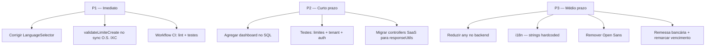

# Relatório de problemas do código

Documento **interno** de auditoria estática do repositório ISP Consultor.  
**Última atualização:** 07/07/2026  
**Escopo:** análise ESLint, padrões do projeto (`.cursor/rules/`), busca por TODOs e revisão de fluxos críticos. Não inclui testes de integração em runtime nem revisão manual de todos os ~1.960 arquivos.

> Documentação para consultores e usuários do ERP fica na wiki pública (`doc/`). Este arquivo fica em `docs/` — uso exclusivo da equipe de desenvolvimento.

---

## Resumo executivo

| Área | Situação |
|------|----------|
| **Backend ESLint** | 445 problemas (410 erros, 35 warnings) em 116 arquivos |
| **Frontend ESLint** | 4 problemas (2 erros, 2 warnings) em 3 arquivos |
| **Testes automatizados** | 0 testes no backend e no frontend |
| **CI/CD** | Workflow de deploy não executa lint nem testes |
| **npm audit** | Sem vulnerabilidades reportadas (backend e frontend) |
| **Bugs funcionais confirmados** | Seletor de idioma (`LanguageSelector`) |
| **Risco de negócio** | Bypass de limite de plano na sync de ordens de serviço (IXC) |

---

## Legenda de severidade

| Nível | Significado |
|-------|-------------|
| **P1 — Crítico** | Bug em produção, risco de segurança/negócio ou escalabilidade grave |
| **P2 — Alto** | Viola regras do projeto, dívida técnica relevante ou inconsistência arquitetural |
| **P3 — Médio** | Funcionalidade incompleta, TODO documentado ou manutenção difícil |
| **P4 — Baixo** | Melhorias, código morto, observações menores |

---

## P1 — Crítico

### 1.1 `LanguageSelector` não altera o idioma

**Arquivo:** `frontend/src/components/common/LanguageSelector.tsx`

O componente importa `setLanguage` do `I18nContext`, mas os itens do dropdown (`NavLinkButton`) **não possuem `onClick`** que chame `setLanguage(lang.code)`.

**Impacto:** seletor de idioma inoperante onde o componente é usado.

**Correção sugerida:** adicionar `onClick={() => setLanguage(lang.code)}` em cada item do menu.

**ESLint:** `'setLanguage' is assigned a value but never used` (`@typescript-eslint/no-unused-vars`).

---

### 1.2 Bypass de limite SaaS na importação de ordens de serviço (IXC)

**Regra violada:** `backend-saas-plano-limites.mdc` — validação obrigatória em **todos** os fluxos de criação, incluindo scheduler/sync.

| Caminho | Valida `validateLimiteCreate`? |
|---------|-------------------------------|
| `IxcOssChamadoController.create` | Sim (`ordens_servico_limite_ordens_servico`) |
| `IxcOsSchedulerRoutineService` → `OrdemServicoLocalService.createIxcMirror` | **Não** |
| `OrdemServicoLocalService.createRecord` | **Não** |

**Arquivos:**

- `backend/src/controllers/ixc/IxcOssChamadoController/index.ts` (validação OK no HTTP)
- `backend/src/services/ordens/IxcOsSchedulerRoutineService/index.ts` (importação sem limite)
- `backend/src/services/ordens/OrdemServicoLocalService/index.ts` (`createRecord`, `createIxcMirror`)

**Impacto:** tenant pode ultrapassar `ordens_servico_limite_ordens_servico` via rotina agendada de espelhamento IXC.

**Correção sugerida:** chamar `SaasPlanoLimitesService.validateLimiteCreate` dentro de `createRecord` / `createIxcMirror` antes de `OrdemServicoLocal.create`.

---

### 1.3 Dashboard carrega todos os registros do tenant

**Arquivo:** `backend/src/controllers/sistema/DashboardController/index.ts`

O endpoint `getDashboardData` busca em paralelo **todos** clientes, contratos e títulos:

```typescript
DashboardService.getAllClientes(empresaId),
DashboardService.getAllTitulos(empresaId),
DashboardService.getAllContratos(empresaId),
```

**Arquivos relacionados:** `backend/src/services/sistema/DashboardService/index.ts` (`getAllClientes`, `getAllTitulos`, `getAllContratos` usam `findAll`).

**Impacto:** degradação de memória, tempo de resposta e carga no MySQL conforme o tenant cresce.

**Correção sugerida:** agregar no SQL (`COUNT`, `GROUP BY`, queries por período) ou endpoints dedicados para gráficos, sem serializar todas as linhas.

---

### 1.4 Ausência total de testes automatizados

| Pacote | Comando | Resultado |
|--------|---------|-----------|
| Backend | `npm test` (Jest) | 0 arquivos de teste — `No tests found` |
| Frontend | `npm test` (craco) | 0 testes — passa apenas com `--passWithNoTests` |

**Impacto:** regressões em financeiro, multi-tenancy, limites de plano e integrações passam sem barreira.

**Correção sugerida:** testes mínimos para `SaasPlanoLimitesService`, `tenantUtils`, auth middleware e fluxos críticos de título/contrato.

---

### 1.5 CI/CD não valida qualidade antes do deploy

**Arquivo:** `.github/workflows/deploy.yml`

O workflow faz checkout, build e deploy. **Não há** job de:

- `npm run lint` (backend/frontend)
- `npm test`
- build condicional como gate de merge (só em push para `main`)

**Impacto:** os 410 erros de ESLint no backend podem ir para produção sem bloqueio automático.

**Correção sugerida:** workflow de PR com lint + testes + build antes do merge; manter deploy separado.

---

## P2 — Alto

### 2.1 Dívida técnica ESLint — backend

**Total:** 445 problemas em **116 arquivos** (`npm run lint` em `backend/`).

| Regra | Ocorrências |
|-------|-------------|
| `@typescript-eslint/no-explicit-any` | 197 |
| `@typescript-eslint/no-unused-vars` | 124 |
| `no-useless-escape` | 60 |
| `@typescript-eslint/no-non-null-assertion` | 35 (warnings) |
| `@typescript-eslint/no-var-requires` | 18 |
| `no-control-regex` | 6 |
| `@typescript-eslint/no-empty-function` | 5 |

**Regra violada:** `backend-api.mdc` — tipagem forte, nunca `any`.

**Áreas mais afetadas:** controllers SaaS, serviços financeiros (`TituloService`), webhooks (Asaas/EFI), SSH/RPKI, `sortHelper.ts`, assinatura digital.

#### Lista completa de arquivos com problemas (backend)

<details>
<summary>116 arquivos — clique para expandir</summary>

- `controllers/agent/AgentController/index.ts`
- `controllers/blockdomi/PdfExtractController/index.ts`
- `controllers/centralAssinante/CentralAssinanteController/index.ts`
- `controllers/comunicacao/MensagemHistoricoController/index.ts`
- `controllers/comunicacao/ServidorEmailController/index.ts`
- `controllers/contratos/ContratoPlanoAdicionalController/index.ts`
- `controllers/contratos/TermoContratoController/index.ts`
- `controllers/documentos/ModeloDocumentoController/index.ts`
- `controllers/financeiro/ContaPagarController/index.ts`
- `controllers/nfse/NFSeConfigController/index.ts`
- `controllers/rpki/RpkiCaController/index.ts`
- `controllers/saas/SaasAuthController/index.ts`
- `controllers/saas/SaasConfigController/index.ts`
- `controllers/saas/SaasCrudController/index.ts`
- `controllers/saas/SaasDadosEmpresaController/index.ts`
- `controllers/saas/SaasDadosEmpresaCrudController/index.ts`
- `controllers/saas/SaasParametrosController/index.ts`
- `controllers/saas/SaasPlanoController/index.ts`
- `controllers/saas/SaasSchedulerController/index.ts`
- `controllers/saas/SaasUsuarioSuperController/index.ts`
- `controllers/scheduler/SchedulerController/index.ts`
- `controllers/scheduler/WorkerController/index.ts`
- `controllers/sistema/BackupController/index.ts`
- `controllers/sistema/DadosEmpresaController/index.ts`
- `controllers/sistema/DashboardController/index.ts`
- `controllers/sistema/ParametrosController/index.ts`
- `controllers/ssh-manager/DeviceController/index.ts`
- `controllers/titulos/TituloBoletoController/index.ts`
- `controllers/titulos/TituloBulkController/index.ts`
- `controllers/titulos/TituloCRUDController/index.ts`
- `controllers/titulos/TituloHelpers/index.ts`
- `controllers/webhooks/EfiWebhookController/index.ts`
- `middleware/auditMiddleware/index.ts`
- `middleware/blockdomiIpsPermitidosMiddleware/index.ts`
- `middleware/csrfMiddleware/index.ts`
- `middleware/errorHandlerMiddleware/index.ts`
- `models/cadastros/Banco/index.ts`
- `models/financeiro/Titulo/index.ts`
- `routes/dadosEmpresaRoutes/index.ts`
- `services/agent/AgentInstallScript.ts`
- `services/assinatura-digital/*` (vários)
- `services/auditoria/AuditoriaPDFService/index.ts`
- `services/bancos/*` (Asaas, EFI, BancoApi)
- `services/blockdomi/*`
- `services/cadastros/*`
- `services/clientes/ClienteService/index.ts`
- `services/comunicacao/*`
- `services/contratos/*`
- `services/documentos/ModeloDocumentoService/index.ts`
- `services/externos/IxcOssChamadoService/*`
- `services/financeiro/*`
- `services/integracao/IntegracaoIxcProvedorService/index.ts`
- `services/nfse/*`
- `services/ordens/IxcOsSchedulerRoutineService/index.ts`
- `services/saas/*`
- `services/scheduler/*`
- `services/sistema/*`
- `services/ssh-manager/*`
- `services/webhooks/*`
- `socket/agentSocket.ts`
- `utils/pagination.ts`, `sortHelper.ts`, `sanitize/index.ts`, `scheduledRoutineSortOrder.ts`, `SchedulerUtils/index.ts`, `saasPlanoHotsiteUtils.ts`

</details>

---

### 2.2 ESLint — frontend

| Arquivo | Linha | Severidade | Problema |
|---------|-------|------------|----------|
| `components/common/LanguageSelector.tsx` | 12 | error | `setLanguage` não utilizado |
| `components/common/RotinaLogsModal.tsx` | 75 | error | `useMemo` com dependência instável (`logs`) |
| `hooks/useErrorHandler.ts` | 43, 67 | warning | `console` em código de produção |

---

### 2.3 Controllers sem `responseUtils`

**Regra violada:** `backend-respostas-http.mdc` — usar sempre `sendSuccess`, `sendError`, `sendValidationError`, etc.

Controllers que ainda usam `res.status().json()` diretamente (amostra):

- `SaasCrudController`
- `SaasAuthController`
- `SaasPlanoController`
- `SaasConfigController`
- `SaasDadosEmpresaController`
- `SaasDadosEmpresaCrudController`
- `SaasTenantUsuarioController`
- `SaasUsuarioSuperController`
- `SaasSchedulerController`
- `SaasParametrosController`
- `BackupController`
- `SchedulerController`
- `ParametrosController`
- `TenantBoletoAtrasoController`
- `PdfExtractController`
- `EfiWebhookController`
- `NFSeConfigController`
- `AssinaturaDigitalController`

**Risco:** formato de resposta inconsistente, logs duplicados ou ausentes.

---

### 2.4 Tipografia — Open Sans importada

**Regra violada:** `frontend-tipografia.mdc` — proibido Google Fonts / fontes externas; usar stack nativa (`--font-family-base`).

**Arquivos:**

- `frontend/src/index.tsx` — imports `@fontsource/open-sans`
- `frontend/package.json` — dependência `@fontsource/open-sans`

---

### 2.5 i18n incompleto no frontend

**Regra violada:** `frontend-i18n.mdc` — textos visíveis devem usar `t()`.

#### Strings fixas em português (amostra)

| Arquivo | Exemplo |
|---------|---------|
| `modals/agent/agentModal/useAgentModal.ts` | `'Informe a senha ou a chave privada'` |
| `modals/agent/AgentInstallModal.tsx` | idem |
| `modals/ssh-manager/sshDeviceModal/useSshDeviceModal.ts` | `'Senha é obrigatória'` |
| `modals/saas/SaasUsuarioFormModal.tsx` | `'Senha é obrigatória'` |
| `modals/servidor/saasServidorFormVariants.ts` | `'Senha é obrigatória'` |
| `modals/contratos/contratoList/useContratoListBulkActions.ts` | confirmação de exclusão em PT fixo |
| `modals/clientes/contrato/abas/RecibosTab.tsx` | idem |
| `modals/clientes/contrato/abas/CartaCobrancaTab.tsx` | idem |
| `modals/parametros/documentos-sistema/abas/DocumentoTab.tsx` | idem |
| `modals/rpki/RpkiCaListModal.tsx` | confirmações em PT fixo |
| `modals/integracao-ixc-provedor/IntegracaoIxcProvedorListModal.tsx` | `'Excluir integração IXC Provedor?'` |

#### `window.alert` em vez de notificação

**Regra violada:** `frontend-erros-api.mdc` / `frontend-ui-centralizado.mdc` — usar `useNotificationContext`, não `alert()`.

**Arquivo:** `frontend/src/components/modals/rpki/rpkiRoaList/useRpkiRoaListBulkActions.ts`

- `window.alert('Nenhuma CA encontrada para análise.')`
- `window.alert('O ROA selecionado não tem prefixo para validar.')`

---

### 2.6 Ordenação e paginação no frontend (listagens server-side)

**Regra violada:** `frontend-tabelas.mdc` / `backend-listagens.mdc` — ordenação no backend.

Modais/listagens que fazem **busca, sort e paginação no cliente** com todos os dados carregados:

| Arquivo | Comportamento |
|---------|---------------|
| `modals/agent/AgentListModal.tsx` | filter + sort + slice local |
| `modals/parametros/BackupsModal.tsx` | sort local |
| `modals/ssh-manager/SshDeviceBackupsPanel.tsx` | sort local |
| `modals/parametros/servidor-whatsapp/TemplateSelectModal.tsx` | sort local |
| `modals/parametros/servidor-whatsapp/abas/TemplatesTab.tsx` | sort local |
| `modals/clientes/contrato/modals/SelecionarTermoModal.tsx` | sort local |
| `modals/dashboard/DashboardBackupEquipamentosModal.tsx` | sort local |
| `hooks/useSorting.ts` | hook genérico de sort client-side |

**Nota:** `useTableSort` em `components/tables/useTable/useTableSort.ts` só ordena no cliente quando `total === filteredData.length` (dataset completo na página). Modais como `AgentListModal` contornam esse padrão intencionalmente.

**Exceção documentada:** RPKI usa paginação client-side por design (`useRpkiListModal`).

---

### 2.7 `RotinaLogsModal` — hook instável

**Arquivo:** `frontend/src/components/common/RotinaLogsModal.tsx`

Expressão `logs` recriada a cada render, invalidando `useMemo` na linha 147 (`react-hooks/exhaustive-deps`).

**Correção sugerida:** envolver inicialização de `logs` em `useMemo` próprio.

---

## P3 — Médio

### 3.1 Funcionalidades incompletas (TODOs)

| Arquivo | Descrição |
|---------|-----------|
| `backend/src/controllers/titulos/TituloCRUDController/index.ts` (~L407) | Remarcação de vencimento na API do banco **não implementada** (`BancoApiService.remarcarVencimento`) |
| `backend/src/services/scheduler/routines/RemessaBancariaRoutine.ts` | Rotina **stub** — aguarda modelos Carne/CarneParcela |
| `backend/src/services/sistema/HealthCheckService/index.ts` | `healthCheckSuccess` atribuída e nunca usada |
| `backend/src/utils/pagination.ts` | `offset` calculado e não utilizado |

---

### 3.2 Limites de plano SaaS — cobertura HTTP vs workers

#### Controllers com validação de limite (OK no HTTP)

| Controller | Método de validação |
|------------|---------------------|
| `ClienteController` | `validateLimiteCreate` (`cadastros_limite_clientes`) |
| `ContratoController` | `validateLimiteCreate` (`cadastros_limite_contratos`) |
| `PlanoController` | `validateLimiteCreate` (`cadastros_limite_planos`) |
| `BancoController` | `validateLimiteCreate` (`cadastros_limite_bancos`) |
| `ModeloDocumentoController` / `ModeloTermoController` | `validateLimiteCreate` (`cadastros_limite_modelos_documento`) |
| `IntegracaoIxcProvedorController` | `validateLimiteCreate` (`ixc_provedor_limite_integracoes`) |
| `IxcOssChamadoController` | `validateLimiteCreate` (`ordens_servico_limite_ordens_servico`) — **mas sync IXC bypassa** |
| `RpkiCaController` | `validateLimiteCreate` (CAs, ROAs, ASPAs, CAs-pai, repositórios) |
| `DeviceController` | `validateEquipamentoCreate` / `validateBackupExecution` |
| `AgentController` | `validateAgentCreate` |
| `UsuarioController` | `validateUsuarioAtivoLimit` |

#### Entidades com limite no plano sem `validateLimiteCreate` no service layer

Criação via HTTP passa pelo controller, mas **services** (`OrdemServicoLocalService`, etc.) não revalidam — qualquer chamada interna (scheduler, sync) pode contornar.

---

### 3.3 `console.log` no backend

**Regra violada:** `backend-middlewares-infra.mdc` — usar `logger`, não `console` em `src/`.

**Exceção aceita:** `backend/src/scripts/build.ts` (script standalone).

**Frontend:** `useErrorHandler.ts` usa `console` para debug em localStorage (2 warnings ESLint).

---

### 3.4 Repositório Git na raiz

O workspace raiz **pode não ser** um repositório Git unificado. Backend e frontend podem estar versionados separadamente — dificulta CI local e rastreio de alterações cross-stack.

---

## P4 — Baixo

### 4.1 Arquivos de debug / latência

| Arquivo | Propósito |
|---------|-----------|
| `frontend/src/utils/sshTerminalLatencyDebug.ts` | Diagnóstico de latência do terminal |
| `backend/src/utils/terminalLatencyDebug.ts` | idem |

**Risco:** código de diagnóstico acessível em produção se não guardado por flag de ambiente.

---

### 4.2 Wiki pública vs sincronização com o código

A rule `doc-wiki.mdc` exige que toda alteração **visível ao usuário** no ERP tenha página em `doc/erp/` (wiki pública). Este relatório **não** auditou feature por feature; qualquer funcionalidade nova sem entrada na wiki é dívida documental para consultores.

---

### 4.3 Pontos positivos

- Limites de plano bem cobertos nos **controllers HTTP** principais
- `npm audit` sem vulnerabilidades reportadas
- Frontend aderente em grande parte às rules de UI (botões centralizados, `window.confirm` para ações destrutivas, poucos `style={{}}`)
- Multi-tenancy com helpers em `tenantUtils.ts`
- Auth com rotas públicas centralizadas em `PUBLIC_ROUTES` (`authMiddleware`)
- Validação de backup em `SshDeviceBackupRunner` e `DeviceController`
- `useTableSort` evita sort client-side quando há paginação server-side real

---

## Plano de correção sugerido



| Prioridade | Item | Esforço estimado |
|------------|------|------------------|
| P1 | `LanguageSelector` + onClick | Baixo |
| P1 | Limite O.S. no `OrdemServicoLocalService` | Baixo |
| P1 | Job CI lint/test | Médio |
| P2 | Dashboard com agregação SQL | Alto |
| P2 | Suite mínima de testes | Alto |
| P2 | `responseUtils` nos controllers SaaS | Médio |
| P3 | Redução de `any` (197 ocorrências) | Muito alto |
| P3 | i18n em massa | Alto |

---

## Como reproduzir a análise

```bash
# ESLint backend
cd backend && npm run lint

# ESLint frontend
cd frontend && npm run lint

# Testes (atualmente vazios)
cd backend && npm test
cd frontend && npm test -- --watchAll=false --passWithNoTests

# Auditoria de dependências
cd backend && npm audit
cd frontend && npm audit
```

---

## Histórico de revisões

| Data | Autor | Notas |
|------|-------|-------|
| 07/07/2026 | Auditoria estática (agente) | Primeira versão do relatório |
